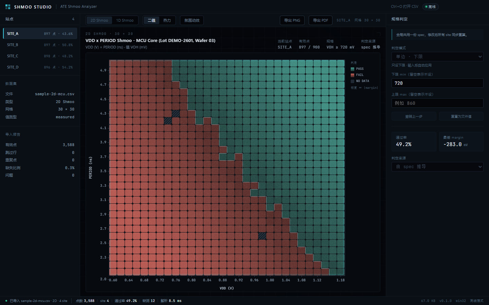
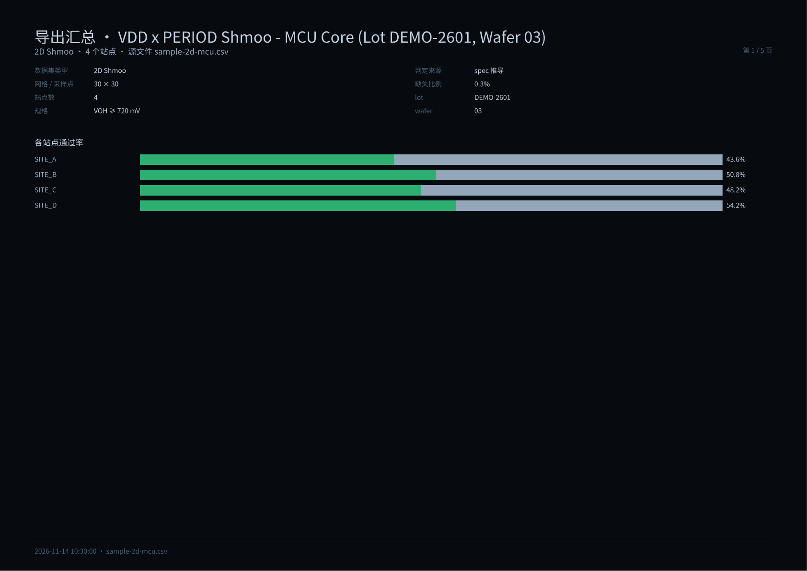

# Shmoo Studio

面向 ATE（芯片测试）工程师的离线桌面工具：导入测试机导出的 CSV 长表，直接看 1D / 2D Shmoo 图，按 site 切换、临时改 spec 即时重算，并把图导出成 PNG 或矢量 PDF。

- 平台：Windows 10 / 11（x64）
- 运行方式：完全离线，不连测试机、不访问网络、不依赖云端
- 界面语言：中文

## 界面预览



2D 二值 Shmoo：左侧按 site 列出点数与通过率，中间是 30 × 30 色块图（青色 PASS、红色 FAIL、斜纹为无数据），右侧可直接改 spec 上下限并即时重算。



导出的 PDF 汇总页：第一页汇总各站点通过率与数据集基本信息，之后每站一页矢量图，文字可选中、可搜索。

## 这个工具是干什么的

测试机（V93000、J750、Chroma 等）跑完 Shmoo 后会导出一份“一行一个测量点”的 CSV。Shmoo Studio 把这堆数字变成能直接看的图：

- **2D Shmoo**：X × Y 网格色块图（例如 VDD × PERIOD），一眼看出通过区形状和边界；
- **1D Shmoo**：单参数扫描曲线或色带（例如只扫 VDD），带 spec 线；
- 一个 site 一张图，左侧点一下就能换 site；
- spec 上下限可以直接在界面上改，所有图立即重算，不用回测试机重跑；
- 看中的图可以导出 PNG 贴报告，或导出文字可选中/可搜索的矢量 PDF。

## 功能

### 图表

| 功能 | 说明 |
| --- | --- |
| 2D 色块图 | 圆角单元格 + 1px 格缝；网格尺寸由数据决定（已验证 1×30、30×30、100×100 等） |
| 2D 两种配色 | **二值**：PASS / FAIL 平涂，并自动描出通过区轮廓；**热力**：按连续测量值渐变，并按 margin 调整明度 |
| 1D 两种形态 | **色带**：按 pass/fail 着色并标出通过区间边界；**曲线**：折线 + 上下 spec 线 + ▲/▼ 越界点 |
| 三态显示 | PASS / FAIL / **无数据**（斜纹填充）。缺失点不计入通过率分母，也不会被当成 FAIL |
| site 切换 | 左侧站点栏按数据里的 site 自动生成，显示每个 site 的点数与通过率；只有一个 site 时不显示切换器 |
| 2D → 1D 切片 | **双击**格子直接切出该格所在的**行**（固定 y、沿 x 取整行）；进入切片后可用工具栏「行方向 / 列方向」切换：行方向固定双击格的 y，列方向固定双击格的 x（取到的就是双击那一列，横轴换成原 y 轴），来回切换两个下标都保留。切片只取当前 site，固定用连续曲线显示，面包屑「2D」返回 |

### spec 与判定

- 支持四种写法：单边下限、单边上限、双边窗口、零宽窗口（`min=1,max=1`，用于 0/1 pattern）；也可写 `none` 表示不比较。
- **spec 全局共用一份**：改一次，所有 site 同步重算，只重算 pass/passCount，不重新解析 CSV。
- 右侧「规格判定」面板可直接编辑下限 / 上限：留空表示不设；输入停顿 250ms 自动应用，回车或失焦立即应用。
- 非法输入（两边都空、非数字、min > max）就地提示，并保留上一次有效结果。
- 支持「撤销上一步」（最多 20 步）和「重置为文件值」。
- 面板实时显示通过率、最差 margin（双边 spec 会标注撞上限还是下限）；二值 / 零宽窗口数据的 margin 显示为「不适用」。

### 交互

- **悬停**：十字准线贯穿全图，浮层显示 x、y、site、value、pass 状态与 margin；靠近边缘时浮层自动翻转，不会被裁掉。1D 图吸附到最近的采样点。
- **锁定**：单击格子锁定读数（浮层常显），再次单击同一格解除。
- **键盘**：方向键移动当前格，Home / End 跳到行首 / 行尾，Enter / Space 锁定，Esc 解除。
- **框选**：按住拖拽形成矩形（或 Shift + 方向键扩展）；底部状态栏显示格数、PASS / FAIL 数、区域通过率、value 范围与均值、最差 margin，并提供「清除」按钮。
- **双击切片**：与单击锁定用 250ms 判定窗口区分，不会互相误触发。
- **拖放导入**：把 `.csv` / `.txt` 文件直接拖进窗口即可打开，与点「打开 CSV」走同一条加载流程；拖拽进入时整窗高亮提示，松开或移出后恢复；拖入非 CSV、空拖拽或超过 20MB 都会给出明确提示，不会静默失败，也不会让 Electron 导航到文件内容页。

### 导出

- **PNG**：2× / 3× 可选，用离屏画布重新绘制（不是放大位图）；不透明底色，只含图表静态内容（色块、坐标轴、刻度、图例、标题与副标题），悬停浮层、锁定描边、框选矩形不会进入图片。
- **矢量 PDF**：A4 横向，一页一张图，圆角格、坐标轴、刻度、虚线、三角标记全部是矢量路径，文字可选中、可搜索；内嵌 Noto Sans SC 子集字体，中文不会变方块。
  - 可勾选「导出全部 site」：按站点顺序每站一页；
  - 可勾选「附带汇总页」：放在第一页，包含各站点通过率对比与数据集基本信息；
  - 切片视图只能导出当前曲线，且不生成汇总页。
- 默认文件名：`数据集名_site_时间戳.png|pdf`（例如 `VDD x PERIOD Shmoo - MCU Core_SITE_A_20261113-142530.png`）；切片导出会带 `-slice` 后缀。非法字符会被清洗，保存对话框默认打开上次导出的目录。

### 分发

- 打包为 **便携版单文件 exe** 与 **NSIS 安装包**，另有一份未压缩目录；均为离线程序，不带自动更新和任何外部请求。
- 程序未做代码签名，首次运行可能出现 SmartScreen「未知发布者」提示。

## 快速开始（使用打包好的程序）

1. 在 `release\` 下选择产物（区别见下文「打包与分发」），双击运行；
2. 点界面中央「打开 CSV」，或按 `Ctrl+O`，或菜单「文件 → 打开 CSV…」，或直接把 CSV 文件拖进窗口；
3. 先拿仓库里的样例试手：
   - `samples\sample-2d-mcu.csv`：30 × 30 网格 × 4 site，单边 `min=720`，含 12 个刻意缺失的格子；
   - `samples\sample-2d-window.csv`：同样的网格，双边 `min=720,max=860`，低压端和高压端都失效；
   - `samples\sample-2d-pattern.csv`：`min=1,max=1`，value 只有 0/1，通过区不规则；
   - `samples\sample-1d-vdd.csv`：1D 扫描，VDD 从 0.600 到 1.180，4 个 site 各 30 点，双边 `min=740,max=860`。

## CSV 格式

### 总体规则

- **长表**：一行一个测量点，不是矩阵表。
- 分隔符为英文逗号 `,`；字段两端空格会被去掉；值里不能出现逗号。
- 编码 UTF-8（带不带 BOM 都行）；换行 CRLF / LF 都行；空行跳过。
- `#` 开头是元数据 / 注释；第一条非 `#`、非空的行是表头；列名大小写不敏感，列顺序任意。
- 首行建议写版本魔数 `#!shmoo-csv 1.0`。
- 单个文件上限 20MB。

### 元数据（`# key: value`）

| key | 必填 | 示例 | 说明 |
| --- | --- | --- | --- |
| `kind` | 否 | `2d` / `1d` | 图形类型；不写时由数据推断（没有 y 列或 y 只有一个取值 → 1D） |
| `title` | 否 | `VDD x PERIOD Shmoo` | 图标题，也用于导出文件名；缺省用文件名 |
| `x_label` / `x_unit` | 否 | `VDD` / `V` | X 轴显示名与单位 |
| `y_label` / `y_unit` | 否 | `PERIOD` / `ns` | Y 轴显示名与单位（1D 不需要） |
| `value_label` / `value_unit` | 否 | `VOH` / `mV` | 测量值名称与单位 |
| `value_type` | 否 | `measured` / `passfail` | 不写时自动推断：有数字且没有 pass 列 → `measured` |
| `spec` | 否 | `min=720`、`max=860`、`min=720,max=860`、`min=1,max=1`、`none` | 规格上下限；数值**不能带单位**（单位由 `value_unit` 决定） |
| `pass_source` | 否 | `derived` / `file` | `derived`（默认）用 spec 推导；`file` 以 CSV 的 `pass` 列为准 |
| `site_labels` | 否 | `1=SITE_A,2=SITE_B` | site 显示名；不写则显示 `Site 1` 之类 |
| `created` | 否 | `2026-11-11T10:30:00+08:00` | 数据生成时间，随元数据保存（PDF 页脚用的是导出时间） |
| `tool` / `lot` / `wafer` / `comment` | 否 | `V93000` / `DEMO-2601` / `03` | 附加信息；`lot`、`wafer` 会显示在 PDF 汇总页 |

`spec` 的判定口径：

| 写法 | 通过条件 |
| --- | --- |
| `min=720` | `value ≥ 720` |
| `max=860` | `value ≤ 860` |
| `min=720,max=860` | `720 ≤ value ≤ 860` |
| `min=1,max=1` | `value == 1`（0/1 pattern 用） |
| `none` | 不比较，所有点判为未知 |

### 数据列

| 列名 | 必填 | 取值 | 说明 |
| --- | --- | --- | --- |
| `x` | 是 | 数字 | 第一维扫描参数（如 VDD） |
| `y` | 2D 必填 | 数字 | 第二维扫描参数（如 PERIOD）；1D 可省，若存在必须全表同值 |
| `site` | 否 | 数字或字符串 | 站点标识；不写视为 `1`；去重后决定 site 数量与顺序 |
| `pass` | 否 | `1/0`、`true/false`、`PASS/FAIL`、空 | 空表示未知；`pass_source=derived` 时该列被忽略 |
| `value` | 否 | 数字或空 | 测量值；空表示无数据。`value_type=passfail` 时可为空 |

缺测有两种合法写法：`value` 留空，或者整行不写（稀疏网格）。两者都会显示为「无数据」斜纹格。

### 最小可运行示例

把下面的内容存成 `demo-2d.csv`，用工具打开即可看到 2 × 2 网格、2 个 site 的 2D 图：

```csv
#!shmoo-csv 1.0
# kind: 2d
# title: DEMO_VDD_PERIOD
# x_label: VDD
# x_unit: V
# y_label: PERIOD
# y_unit: ns
# value_label: VOH
# value_unit: mV
# value_type: measured
# spec: min=720,max=860
# pass_source: derived
# site_labels: 1=SITE_A,2=SITE_B
# lot: DEMO-0001
# wafer: 01
x,y,site,pass,value
0.70,2.0,1,0,690
0.70,3.0,1,1,780
0.80,2.0,1,1,801
0.80,3.0,1,0,872
0.70,2.0,2,1,755
0.70,3.0,2,1,812
0.80,2.0,2,0,884
0.80,3.0,2,1,770
```

要点：`spec` 用 `min=720,max=860`，所以 690、872、884 判 FAIL，其余判 PASS（`pass_source=derived` 时 `pass` 列只作记录，不参与着色）。把 `kind` 改成 `1d` 并去掉 `y` 列，就是一份 1D 数据。

## 界面使用

### 1. 导入

点中央「打开 CSV」、按 `Ctrl+O`、走菜单「文件 → 打开 CSV…」，或者**把 `.csv` / `.txt` 文件直接拖进窗口**（拖拽过程中整窗会高亮，松开即导入）。四种入口最终都走同一条解析流程，结果一致；拖入的不是 CSV、没有文件或超过 20MB 时，状态栏与提示条会明确说明原因，当前数据集保持不变。导入后：

- 左栏「数据集」显示文件名、类型、网格尺寸、值类型；
- 左栏「导入报告」显示有效点、跳过行、重复点、缺失比例、问题条数；顶栏出现「N 条导入提示」时可对照报告排查；
- 底部状态栏显示点数、site 数、总体通过率、缺测数、解析耗时。

### 2. 切换 site

左栏「站点」里每个 site 一个按钮，显示该站点的点数与通过率，点一下即切换当前图。只有 1 个 site 时不显示按钮，只显示一行只读信息。

### 3. 2D / 1D 与配色

图形类型由 CSV 决定（`kind` 或 y 列），界面顶部的「2D Shmoo / 1D Shmoo」只是当前类型标识，不能强行切换：

- 2D 数据集：工具栏「二值 / 热力」切换配色；整个数据集只有一两种取值时「热力」置灰（提示「二值数据，无连续量」）；
- 1D 数据集：工具栏「色带 / 曲线」切换形态；
- 2D 还可打开「氛围动效」（边界轻微呼吸 + 噪点缓慢流动，默认关闭）。

### 4. 修改 spec

在右侧「规格判定」面板：

- 需要单边下限就只填「下限 min」，需要单边上限就只填「上限 max」，两边都填就是双边窗口，`min` 与 `max` 相等就是零宽窗口（pattern）；
- 留空表示不设；输入停顿 250ms 自动应用，回车或点别处立即应用；
- 改完所有 site 立即重算，通过率、最差 margin、色块与轮廓同步更新；
- 输入非法时红框提示并保留上一次有效结果；「撤销上一步」「重置为文件值」可回到之前状态或 CSV 原值。

### 5. 读数与框选

- 鼠标悬停看单个点的数值与 margin；
- 单击锁定，再次单击或按 `Esc` 解除；方向键 / Home / End / Enter / Space 可纯键盘操作；
- 按住拖拽框选一片区域，底部状态栏出现区域统计，点「清除」或按 `Esc` 取消。

### 6. 切片

在 2D 图上双击某个格子（同一格 250ms 内的第二次点击），进入该格所在行对应的 1D 曲线。注意触发方式与范围：

- **双击即记录该格的行与列**：固定该格的 y 值沿 x 轴取一整行（30 × 30 网格就是取 30 个点），同时把该格的 x 下标（列）也一并记住；框选矩形只做区域统计，不会触发切片。
- 进入切片后，工具栏出现「行方向 / 列方向」：
  - 「行方向」= 固定 y、横轴为原 x 轴，取的是双击格所在的**行**；
  - 「列方向」= 固定 x、横轴为原 y 轴（轴标题和单位随之换成 y 轴），取的是双击格所在的**列**；
  - 两个方向共用双击时记下的 x / y：来回切换只改变方向，行号与列号都不会丢，因此任何时候切回来看到的都是双击那一行 / 那一列。下标越界时各自夹到最后一行 / 最后一列，夹取只取决于当前数据维度，不会用另一方向的下标顶替。
- 切片只取左侧当前选中的**一个 site**，不做多 site 叠加；切换 site 后同一条行 / 列的读数会按新 site 重算。
- 切片视图**固定用连续曲线**绘制（切片时工具栏的色带 / 曲线开关会被行方向 / 列方向替换），顶部面包屑显示 `2D › PERIOD = 3.4 ns › 1D 曲线`，点「2D」返回。
- 此时右侧面板与页眉改为显示这条曲线自己的通过率、最差 margin 和最长连续 PASS 区间。

### 7. 导出

- 工具栏「导出 PNG」「导出 PDF」，或菜单「文件 → 导出 PNG…（Ctrl+Shift+P）」「导出 PDF…（Ctrl+P）」；
- PNG：选 2× / 3×，对话框会提示输出像素尺寸；
- PDF：可选「导出全部 site」「附带汇总页」，对话框会提示总页数；
- 点导出后在系统保存对话框里选位置，默认目录是上次成功导出的目录。

## 从源码运行与打包

### 环境

- Node.js 18 或更高（建议 20 LTS）+ npm；
- Windows 10 / 11；
- 仓库内的 `.npmrc` 已把 Electron 与 electron-builder 的二进制指向国内镜像，网络受限时也能装依赖。

### 开发模式

```powershell
npm install
npm run dev
```

`electron-vite dev` 会同时启动渲染进程开发服务器和 Electron 窗口，改代码自动热更新。

### 构建

```powershell
npm run build
```

产物在 `out\`（主进程、preload、渲染层）。想先看构建结果而不打包，可以运行：

```powershell
npm run preview
```

### 打包

```powershell
npm run dist
```

等价于 `npm run build` + `electron-builder`，产物输出到 `release\`。

### 测试与类型检查

```powershell
npm test
npm run typecheck
```

`npm test` 用 Vitest 跑解析、spec 判定、几何与配色、1D / 切片、交互、导出（PNG / PDF）等用例；`npm run typecheck` 分别检查主进程、渲染层和测试代码。

### 打包产物与怎么选

以 0.1.0 为例，`release\` 下会有三份东西：

| 产物 | 形态 | 特点 | 适合谁 |
| --- | --- | --- | --- |
| `release\win-unpacked\Shmoo Studio.exe` | 未压缩目录 | 免安装、免解压，整个文件夹拷走就能跑；启动最快 | 本机调试、想直接看程序文件结构 |
| `release\Shmoo Studio-0.1.0-portable.exe` | 单文件便携版 | 双击即用，不写注册表、不建快捷方式；每次启动会自解压到临时目录，首次启动稍慢 | 日常发给同事、U 盘带走、实验室多台机器轮换 |
| `release\Shmoo Studio-0.1.0-x64.exe` | NSIS 安装包 | 可改安装目录，创建桌面 / 开始菜单快捷方式，卸载时保留应用数据 | 固定工位长期使用 |

一般分发选**便携版**；要长期装在某一台机器上选**安装包**；`win-unpacked` 主要留给自己排查。三者功能完全一致，都离线运行。

### 目录结构

```
src\main\            主进程：窗口、菜单、文件对话框、PNG/PDF 写盘、矢量 PDF 绘制
src\preload\         contextBridge 白名单 API
src\shared\          主/渲染共用纯逻辑：CSV 解析校验、spec 判定、导出文案
src\renderer\        React 界面、三层 Canvas 渲染、交互、状态管理
samples\             可以直接打开的示例 CSV
tests\               Vitest 用例
docs\                设计文档、文件职责清单与阶段记录
resources\           应用图标
release\             electron-builder 产物（不入库）
```

## 常见问题

- **图是空的 / 全是「未知」**：检查 CSV 是否有 `spec`，或 `pass_source` 是否写成了 `derived` 但没给 spec。
- **1D 数据被识别成 2D（或反过来）**：显式写 `# kind: 1d` / `# kind: 2d`；1D 若保留 y 列，必须全表同值。
- **某些格子是斜纹**：这些位置在 CSV 里没有数据（`value` 为空或缺行），不是 FAIL，也不进通过率分母。
- **改了 spec 但 CSV 的 pass 列颜色没变**：`pass_source: file` 时以文件里的 pass 为准，spec 只影响统计口径；需要让 spec 说了算就写成 `pass_source: derived`。
- **PDF 里的中文**：程序自带 Noto Sans SC 子集并嵌入 PDF，不需要目标机器装字体。

## 许可证

本项目以 [MIT 许可证](LICENSE) 发布：可以自由使用、修改、商用和再分发，只需保留版权声明与许可声明。

`LICENSE` 里的版权署名目前是占位写法「Shmoo Studio contributors」；如需以自己的姓名或组织名义发布，替换首行即可。

## 第三方组件

| 组件 | 用途 | 许可证 |
| --- | --- | --- |
| Noto Sans SC（字符子集，内嵌） | 导出矢量 PDF 时嵌入中文字形，目标机器无需安装字体 | SIL Open Font License 1.1，见 `assets/fonts/LICENSE-NotoSansSC.txt` |
| JetBrains Mono（拉丁字符子集，内嵌） | 界面数字与坐标刻度的等宽字形 | SIL Open Font License 1.1，见 `src/renderer/assets/fonts/OFL.txt` |

两款字体均按 OFL 1.1 随程序嵌入分发，原版权与许可声明已保留在仓库对应目录中。
